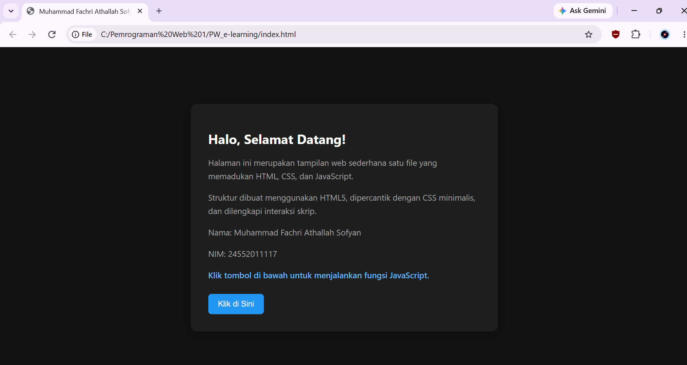
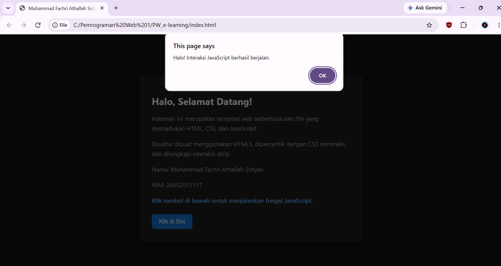
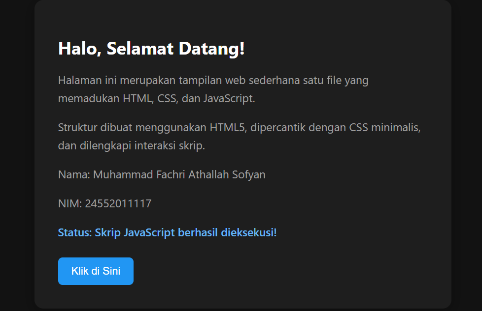

# Tugas Website 1 Halaman

Website sederhana satu halaman menggunakan HTML, CSS, dan JavaScript.

## Tampilan Browser

### 1. Tampilan Awal

### 2. Pengujian Skrip JavaScript

### 3. Hasil Interaksi JavaScript
